# M&A Tenancy Control Plane

**Isolate on Day 1. Converge by Day 365. Carve out in a weekend.**

A working control plane for onboarding acquired companies into a parent's platform. It is built for the problem CEOs, CFOs, CIOs, CISOs and General Counsel at Fortune 100 companies, banks, federal agencies and parastatals actually face after the deal is signed. In one sentence:

> *"How do we bring this company in fast enough to bank the synergies, without breaching antitrust rules before close, leaking regulated data across borders, inheriting their fraud paths, or making a forced divestiture impossible?"*

It runs today with **zero runtime dependencies** (Python 3.10+ stdlib only). It has 28 tests, a 13-step scripted demo, a live dashboard and JSON API, Terraform modules for each tenancy tier, Postgres Row-Level Security with its own test, and the diagrams below.

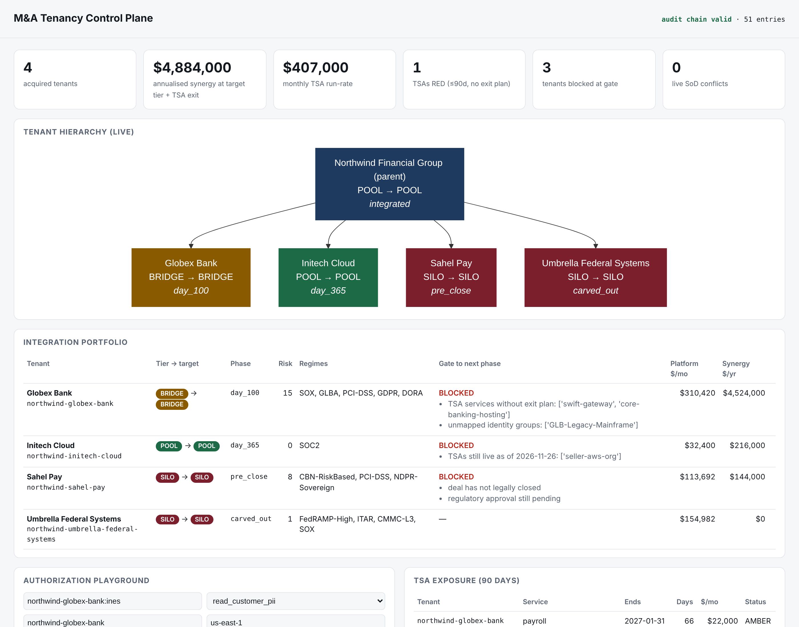

```bash
git clone <this repo> && cd mna-tenancy-onboarding
make demo        # 13-step walkthrough: 4 acquisitions, every control exercised
make serve       # same, then the live dashboard at http://localhost:8080
make test        # 28 tests
docker compose up --build   # control plane + Postgres with RLS
```

---

## The problem, in board language

| Executive | Question this repo answers | Where |
|---|---|---|
| **CEO / Board** | Which acquisitions are on track for Day 100, and what is blocking the rest? | Phase gates, dashboard |
| **CFO** | What synergy do we unlock by converging each tenant, and what is the TSA burn? | `finance.py`, dashboard KPIs |
| **General Counsel** | Can anyone outside the clean team see target data before close (gun-jumping)? | Policy rule **R1** |
| **CISO** | Are their admins, MFA gaps and toxic role combinations coming in with them? | Identity federation, Day-1 gate |
| **CRO / Compliance** | Does EU, Nigerian or US-federal data stay where the law says it must? | Rules **R2/R3**, SCP region lock |
| **CIO** | Silo, bridge or pool for each deal, and what does the landing zone look like? | Tiering engine, Terraform |
| **Regulator / Auditor** | Show me every access decision and prove nobody edited the log. | Hash-chained audit |
| **Board (exit)** | If we are ordered to divest, can we hand it back cleanly, with evidence? | Carve-out engine |

---

## Architecture

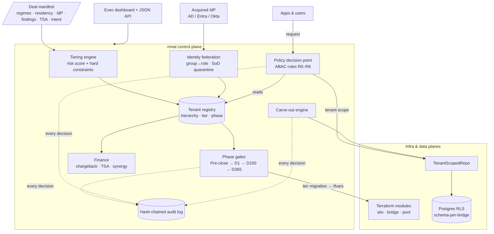
<sub>Source: [`docs/diagrams/01-architecture.mmd`](docs/diagrams/01-architecture.mmd) · [SVG](docs/diagrams/01-architecture.svg)</sub>

## Three tenancy tiers, one convergence path

Pick the wrong tenancy model and you either stall the integration, which costs you synergies, or merge too fast and breach a regulator or the antitrust rules. This repo makes the tenancy model **a per-deal decision that changes over time**, not one architecture applied to everyone.

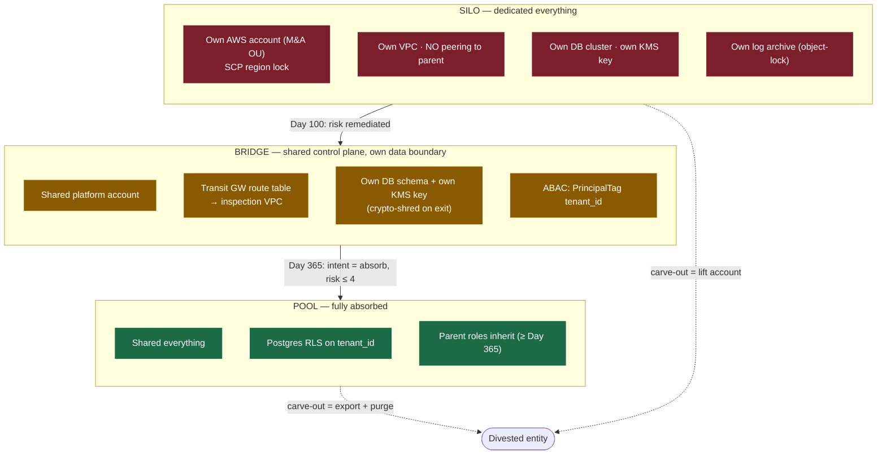
<sub>Source: [`docs/diagrams/02-tenancy-tiers.mmd`](docs/diagrams/02-tenancy-tiers.mmd) · [SVG](docs/diagrams/02-tenancy-tiers.svg)</sub>

| | SILO | BRIDGE | POOL |
|---|---|---|---|
| Isolation | Dedicated account, VPC, DB, KMS | Dedicated schema + KMS on a shared platform | Row-level (`tenant_id`) |
| Network to parent | **None** | Transit GW, forced through inspection | Shared |
| Parent roles inherit? | Never | Consolidation only (finance/audit read) | Fully, from Day 365 |
| Fixed platform cost/mo* | $42,000 | $11,000 | $1,500 |
| Carve-out | Lift the account | Crypto-shred key + drop schema | Export + purge rows |
| Typical deal | FedRAMP / ITAR / sovereign, divest-likely | Regulated bank, standalone brand | SaaS tuck-in |

\*Illustrative rate card. Override with `rates/ratecard.json`.

## How the tier is decided

Every decision is **explainable**. The engine returns each risk point and each hard constraint as a sentence an auditor can read.

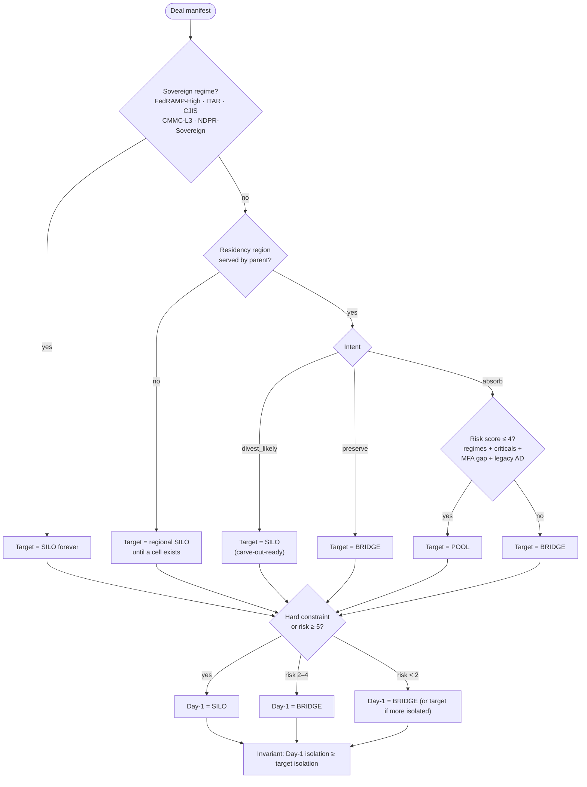
<sub>Source: [`docs/diagrams/03-decision-tree.mmd`](docs/diagrams/03-decision-tree.mmd) · [SVG](docs/diagrams/03-decision-tree.svg)</sub>

Output for the four sample deals (from `make demo`):

```
  target                     risk  day-1   target   hard constraints
  globex-bank                  15  silo    bridge   -
  initech-cloud                 0  bridge  pool     -
  umbrella-federal-systems      1  silo    silo     sovereign regime(s) ['CMMC-L3','FedRAMP-High','ITAR'] -> dedicated SILO, never pooled; residency ['us-gov-west-1'] not served ...
  sahel-pay                     8  silo    silo     sovereign regime(s) ['NDPR-Sovereign'] ...; residency ['af-south-1'] not served ...; regulatory approval pending ...
```

## Integration lifecycle with hard gates

A tenant **cannot** advance while a gate fails, unless someone forces it, which is recorded as a CRITICAL audit event listing the waived failures. When a tenant advances, it moves to the next tier on its convergence path and its Terraform tfvars are re-rendered, so `terraform plan` shows the infrastructure move.

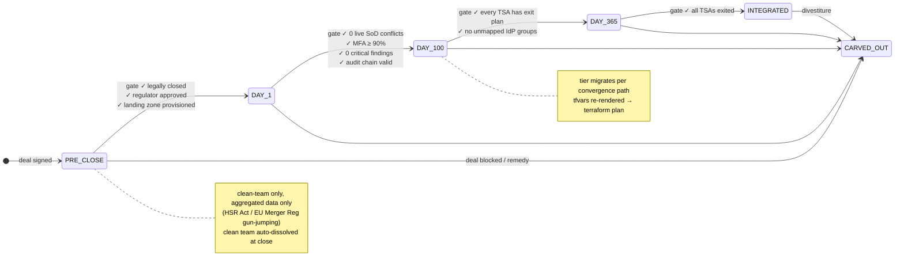
<sub>Source: [`docs/diagrams/04-lifecycle.mmd`](docs/diagrams/04-lifecycle.mmd) · [SVG](docs/diagrams/04-lifecycle.svg)</sub>

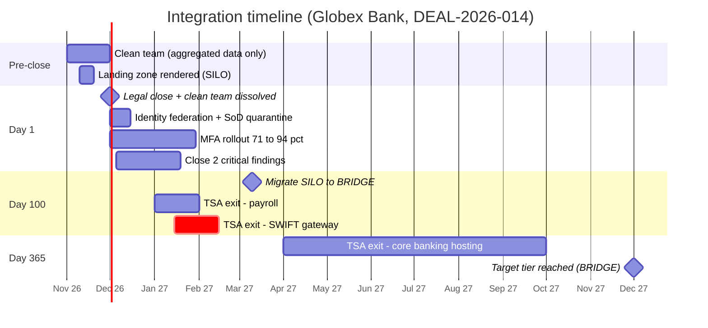
<sub>Source: [`docs/diagrams/09-integration-timeline.mmd`](docs/diagrams/09-integration-timeline.mmd) · [SVG](docs/diagrams/09-integration-timeline.svg)</sub>

## Access control: every request, every rule, every time

Rules are evaluated deny-first. Every decision, allow or deny, is written to the audit chain along with the rule that decided it.

| Rule | What it enforces | Why the executive cares |
|---|---|---|
| **R0** | Tenant exists and is not carved out | Divested means divested |
| **R1** | Pre-close: clean team only, aggregated data only | HSR Act / EU Merger Regulation gun-jumping fines |
| **R2** | Sovereign tenants require `us_person` (or local-national) | ITAR / FedRAMP / NDPR |
| **R3** | Customer or PII access must come from a permitted region | GDPR, DORA, data-localisation laws |
| **R4** | Break-glass needs parent `security_admin` + justification; logged CRITICAL | Incident response without standing access |
| **R5** | Direct grant on the target tenant | Least privilege |
| **R6** | Parent roles inherit only as the tier and phase allow | "Bridge" really is a bridge |

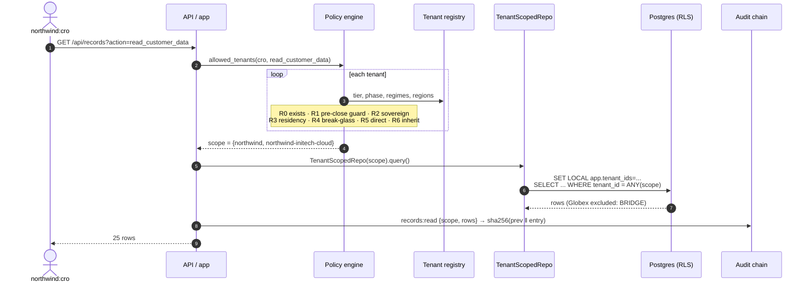
<sub>Source: [`docs/diagrams/05-authz-sequence.mmd`](docs/diagrams/05-authz-sequence.mmd) · [SVG](docs/diagrams/05-authz-sequence.svg)</sub>

## Identity: federate, don't merge

On Day 1 we federate the acquired IdP. We don't merge directories. Toxic role combinations that only appear once groups are mapped get the **approval side quarantined**, so people keep their day job and the fraud path never goes live. Unmapped groups block the Day-100 gate.

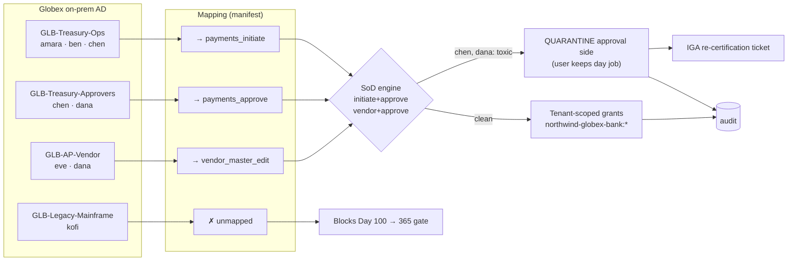
<sub>Source: [`docs/diagrams/06-identity-federation.mmd`](docs/diagrams/06-identity-federation.mmd) · [SVG](docs/diagrams/06-identity-federation.svg)</sub>

## Network topology

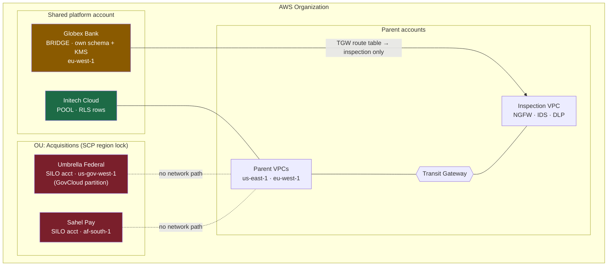
<sub>Source: [`docs/diagrams/07-network-topology.mmd`](docs/diagrams/07-network-topology.mmd) · [SVG](docs/diagrams/07-network-topology.svg)</sub>

## Carve-out: the test of a good tenancy model

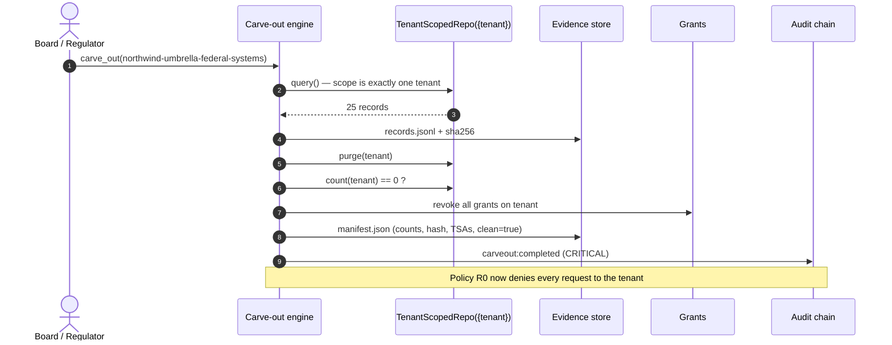
<sub>Source: [`docs/diagrams/08-carveout.mmd`](docs/diagrams/08-carveout.mmd) · [SVG](docs/diagrams/08-carveout.svg)</sub>

## Live portfolio (generated by the running system)

This diagram is produced by `GET /api/hierarchy.mmd` after `make demo`. The dashboard renders it live.

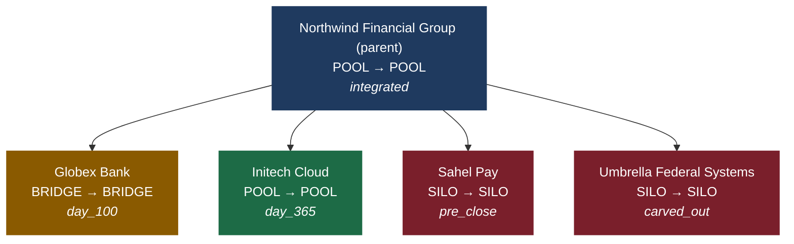
<sub>Source: [`docs/diagrams/10-live-portfolio.mmd`](docs/diagrams/10-live-portfolio.mmd) · [SVG](docs/diagrams/10-live-portfolio.svg)</sub>

---

## Hands-on: drive it yourself

```bash
export PYTHONPATH=src MNAT_DB=my.db
python -m mnatenancy bootstrap deals/parent-northwind.json
python -m mnatenancy onboard   deals/globex-bank.json

# Pre-close: gun-jumping guard
python -m mnatenancy authorize northwind:cro     read_aggregated_financials northwind-globex-bank   # DENY R1
python -m mnatenancy authorize northwind:corpdev read_aggregated_financials northwind-globex-bank   # ALLOW (clean team)

# Close the deal and walk the gates
python -m mnatenancy gates     northwind-globex-bank
python -m mnatenancy remediate northwind-globex-bank closed true
python -m mnatenancy advance   northwind-globex-bank                        # -> day_1 (SILO)
python -m mnatenancy gates     northwind-globex-bank                        # MFA 71%, 2 criticals
python -m mnatenancy remediate northwind-globex-bank mfa_coverage_pct 94
python -m mnatenancy remediate northwind-globex-bank critical_security_findings 0
python -m mnatenancy advance   northwind-globex-bank                        # -> day_100, SILO -> BRIDGE

# Residency
python -m mnatenancy authorize northwind-globex-bank:ines read_customer_pii northwind-globex-bank --region us-east-1   # DENY R3
python -m mnatenancy authorize northwind-globex-bank:ines read_customer_pii northwind-globex-bank --region eu-west-1   # ALLOW

# TSA exit plans, CFO view, audit
python -m mnatenancy exit-plan northwind-globex-bank swift-gateway "Cut over to parent SWIFT Alliance Lite2"
python -m mnatenancy show      northwind-globex-bank
python -m mnatenancy audit --verify
python -m mnatenancy serve --port 8080
```

### HTTP API

| Method | Path | Purpose |
|---|---|---|
| GET | `/` | Executive dashboard (KPIs, live hierarchy, gates, authz playground, TSA, audit) |
| GET | `/api/portfolio` | Board view: every tenant, blockers, synergy, TSA exposure, audit status |
| POST | `/api/deals` | Onboard a deal manifest (JSON body) → `201` |
| GET | `/api/tenants/{id}` | Tenant + gates + SoD + chargeback + TSAs |
| POST | `/api/tenants/{id}/advance` | Advance phase (`409` with blockers if a gate fails) |
| POST | `/api/tenants/{id}/remediate` | `{field, value}`: closed, MFA, findings, approvals |
| POST | `/api/tenants/{id}/sod/resolve` | `{principal, drop_role}` |
| POST | `/api/tenants/{id}/tsa/exit-plan` | `{service, plan}` |
| POST | `/api/tenants/{id}/carveout` | Export, purge, revoke, evidence manifest |
| POST | `/api/authorize` | `{principal, action, tenant, ctx}` → `200`/`403` + rule |
| GET | `/api/records?principal=` | Policy-scoped read via `TenantScopedRepo` |
| GET | `/api/audit`, `/api/audit/verify` | Audit trail and chain verification |
| GET | `/api/hierarchy.mmd` | Live Mermaid diagram of the tenant tree |

```bash
curl -s localhost:8080/api/portfolio | jq '.tenants[] | {name, tier, target_tier, phase, gate_ready, blockers}'
curl -s -XPOST localhost:8080/api/authorize -d '{"principal":"northwind:cro","action":"read_customer_data","tenant":"northwind-globex-bank"}'
```

### Onboard your own deal

Copy `deals/globex-bank.json` and edit it. The fields map directly to what an integration management office (IMO) already tracks: regimes, residency, headcount, app count, open critical findings, IdP, MFA coverage, pending approvals, clean-team roster, AD group → role mappings, TSAs and monthly usage.

---

## Repository map

```
src/mnatenancy/
  models.py      Tier, Phase, Intent, DealManifest, Tenant
  tiering.py     Explainable tier decision (risk score + hard constraints + convergence path)
  identity.py    Role catalogue, SoD rules, federation with quarantine
  policy.py      ABAC engine R0–R6, tenant-scope resolution
  phases.py      Gate checks, advance (tier migration + tfvars re-render), remediation
  store.py       SQLite store, TenantScopedRepo, hash-chained audit
  finance.py     Rate card, chargeback, synergy, TSA exposure
  carveout.py    Export → purge → verify zero residual → revoke → evidence manifest
  playbook.py    Manifest → tenant → landing zone → identity → TSA → audit
  service.py     Application service shared by API and CLI
  api.py         Stdlib HTTP API;  dashboard.html  live executive dashboard
  cli.py         `mnat` CLI;  demo.py  13-step scripted walkthrough
deals/           Parent + 4 acquisitions (bank, SaaS, federal contractor, Nigerian fintech)
terraform/       modules/tenant-{silo,bridge,pool} + envs/example consuming rendered tfvars
sql/             postgres_rls.sql (RLS + schema-per-bridge + append-only audit), rls_test.sql
docs/            diagrams/*.mmd + *.svg, exec-brief.md, runbook-day1.md, adr/, demo-output.txt
tests/           28 tests: tiering, gun-jumping, SoD, residency, sovereign, break-glass,
                 tenant isolation, audit tamper, carve-out, chargeback, tfvars, HTTP API
```

## From reference implementation to production

| Here | In production |
|---|---|
| SQLite + `TenantScopedRepo` | PostgreSQL with `FORCE ROW LEVEL SECURITY` (`sql/postgres_rls.sql`, tested in CI) |
| Python policy engine | Same rules in OPA/Rego or Cedar (Amazon Verified Permissions) as the PDP |
| Role catalogue in code | SailPoint / Saviynt / Entra ID Governance |
| Hash chain in a table | Same chain + periodic anchoring to S3 Object Lock / QLDB-style ledger |
| Rendered tfvars | Account Factory for Terraform / Control Tower, GitOps-applied |
| Rate card JSON | FinOps CUR data per tenant tag |

## Docs

- [Executive brief](docs/exec-brief.md): the one-pager for the board pack
- [Day-1 runbook](docs/runbook-day1.md): hour-by-hour for the IMO
- [ADR-001 Tier per deal, not per company](docs/adr/001-tier-per-deal.md)
- [ADR-002 Federate, don't merge identity](docs/adr/002-federate-identity.md)
- [ADR-003 Hash-chained audit](docs/adr/003-hash-chained-audit.md)
- [Full demo transcript](docs/demo-output.txt)

*All company names are fictional. Regulatory references are summaries for engineering design, not legal advice.*

License: Apache-2.0
